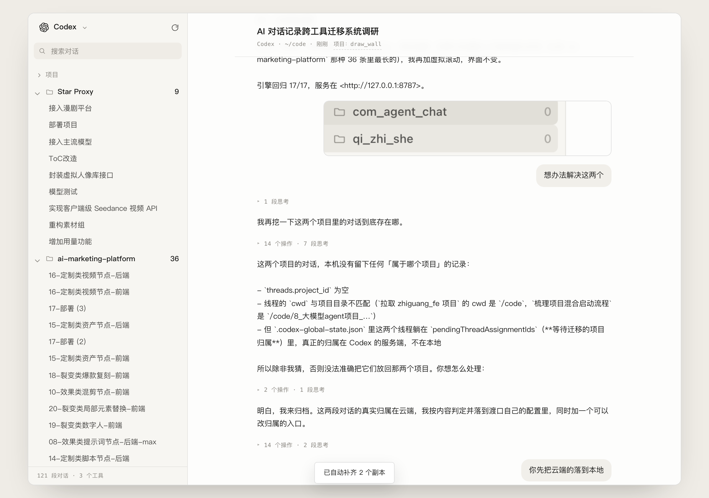

# 渡口 · Dukou

渡口读取 **Codex、Claude Code、DeepSeek Harness（DSH）、Kimi Code 和 ZCode** 的本机会话，通过统一消息格式查看对话并比较副本。Codex、Claude Code、DSH 和 ZCode 可作为迁移目标；Kimi Code 目前只读，因为官方接口没有完整历史导入能力。



> 当前实现仍在验证中。迁移会写入各工具的本地会话文件和索引；ZCode 写入器会先备份数据库并检查 schema。首次使用建议先运行 `--dry-run`，并保留备份。真实会话之间可能已有历史差异，不应把“同步”理解为覆盖或自动修复。

## 功能

- 单向迁移或对已有镜像组增量同步；支持 CLI 和本机 Web 界面。
- 迁移文本、思考、工具调用与结果，以及用户、助手和工具结果中的图片。
- 图片按原始字节搬运；工具调用与结果保留关联。
- 本机实时监听镜像组变化；支持备份、幂等检查和写入前校验。

## 环境要求

- macOS；支持的工具有本地会话存储。Kimi Code 读取要求其本地 Server API 已启动并可用。
- Node.js **24 或更高版本**（需要 `node:sqlite` 和 zstd 支持）。
- 如果系统 Node 版本不合适，可使用 DSH 随附运行时：

```sh
export DSH_NODE_EXECUTABLE="/Applications/DeepSeek Harness.app/Contents/MacOS/DeepSeek Harness"
```

`scripts/web.sh` 会优先使用 `DSH_NODE_EXECUTABLE`，否则使用符合要求的 `node`。

## 启动 Web 界面

```sh
npm run web
```

默认访问 <http://127.0.0.1:8787>。服务只绑定本机回环地址，**没有身份验证**；不要把它暴露到局域网或公网。

## CLI 快速开始

以下命令假设当前 `node` 为 24+；也可以把 `node` 替换为 `$DSH_NODE_EXECUTABLE`。

```sh
# 查看各工具会话数量
node src/cli.ts stats

# 列出并检查源会话
node src/cli.ts list --from dsh --limit 20
node src/cli.ts dump --from dsh --id session-<uuid> --limit 20

# 先预演：不会写入目标会话
node src/cli.ts sync --from dsh --id session-<uuid> --to codex,claude --dry-run

# 确认预演结果后执行迁移/增量同步
node src/cli.ts sync --from dsh --id session-<uuid> --to codex,claude

# 查看镜像组及副本消息数量
node src/cli.ts doctor
```

可用来源为 `codex`、`claude`、`dsh`、`kimi`、`zcode`；目标为 `codex`、`claude`、`dsh`、`zcode`。Kimi Code 读取使用 `~/.kimi-code/server/instances/` 注册的官方 loopback Server API（CLI 可用 `kimi web` 启动），令牌只从本机读取、不输出；支持 `KIMI_CODE_HOME` 覆盖。ZCode 读取 `~/.zcode/cli/db/db.sqlite`，写入会更新本地 session/message/part 数据库和桌面 tasks index，并将图片放入 `cli/artifacts/`；支持 `ZCODE_HOME` 覆盖。ZCode 数据库写入基于已检查的本地 schema，不是官方导入 API；写入前会在 `dukou-backups/`（或 `--backup` 指定目录）保留 SQLite 快照。同步台账默认写在 DSH 数据目录下；可通过 `--ledger <path>` 指定。`sync` 还支持 `--codex-home`、`--claude-home`、`--dsh-home`、`--kimi-home`、`--zcode-home`、`--backup` 和 `--dry-run`。导出单个新副本可使用：

```sh
node src/cli.ts export --from dsh --id session-<uuid> --to claude --home /tmp/claude-test
```

`--home` 可用于隔离测试，避免写入默认会话目录。

## 图片和迁移边界

图片会内联写入 Claude/Codex 会话；DSH 使用内容寻址附件存储。Codex 的对话图片还会写入 `imageView` 投影，以便桌面端显示。旧会话中的工具结果可能以纯文本、结构化块或历史序列化字符串保存，渡口会尽量归一化这些格式。

目标工具不支持的内容无法保证完全原生呈现；真实镜像组也可能包含迁移前已存在的差异。执行写入前请查看预演和备份，不要仅凭消息数量判断内容相同。

## 验证

```sh
npm run regression
```

浏览器测试需要先启动 Web 服务，并安装 Google Chrome（macOS 默认路径），再运行：

```sh
npm run web-browser
```

新端回归覆盖 Kimi API 读取、ZCode SQLite 读取/写入、工具调用、图片数据和增量追加；运行 `npm run regression:new-harnesses`。隔离浏览器联调会从 Claude Code 发送完整 fixture 到 ZCode，并检查消息顺序与图片显示；运行 `npm run web-browser:zcode`。ZCode 3.19.1 桌面端已重开合成验收会话，确认项目分组、消息次序和 PNG 预览正常。Kimi 发送保持关闭：官方 session API 可创建会话和提交 prompt，但没有任意多轮历史导入接口；官方 CLI 导入说明也不提供完整原样的多轮迁移。详细记录见 [`docs/superpowers/plans/2026-11-22-kimi-zcode-integration.md`](docs/superpowers/plans/2026-11-22-kimi-zcode-integration.md)。真实数据检查可能因已有会话差异而失败；失败时应先调查，不要为通过测试而盲目同步或删除历史。

### 真实项目迁移复核（2026-11-22）

- 浏览器平台从一个 Codex 项目迁移了全部有消息的对话到 ZCode；空对话被识别为 0 条并跳过，没有创建空副本。
- 两段稳定对话在平台复核时分别显示 148/148 和 1609/1609 条一致。活跃对话在验收期间持续增长，平台按内容指纹增量追加；因此它的数量只代表检查时的快照。
- 三个目标会话共检查到 87 个图片附件引用；对应的 ZCode artifact 文件均存在，图片 data URL 均可解码。合成验收会话已在桌面端打开并预览图片；真实迁移会话的每张图片未逐张在桌面端打开检查。
- ZCode 对话内消息使用显式 sequence 排序。ZCode 任务列表按最近更新排序，因此任务在项目侧栏中的排列可能与 Codex 的项目顺序不同。
- Web 工具选择器使用 Kimi Code 桌面客户端图标和 ZCode 品牌字标，便于区分来源。
- Kimi Code 保持只读，遵循官方接口方案；官方接口不支持导入任意完整多轮历史。

## 项目结构

| 目录/文件 | 内容 |
|---|---|
| `src/adapters/` | Codex、Claude Code、DSH、Kimi Code、ZCode 会话读取器 |
| `src/writers/` | Codex、Claude Code、DSH 和 ZCode 会话写入器 |
| `src/ir.ts`、`src/mirror.ts` | 统一消息格式与迁移/同步引擎 |
| `src/ledger.ts`、`src/groups.ts` | 镜像台账与实时收敛 |
| `web/` | 本机 Web 服务、浏览器界面与 transcript 构建 |
| `scripts/` | 回归测试、浏览器测试及维护脚本 |
| `docs/` | 架构、前端设计与验收记录 |

## 安全说明

渡口直接访问本机各工具的会话文件、附件和索引数据库。迁移可能创建或追加会话，并更新本地索引和台账。请先备份重要数据、预演目标，并避免在共享机器上开放服务端口。
